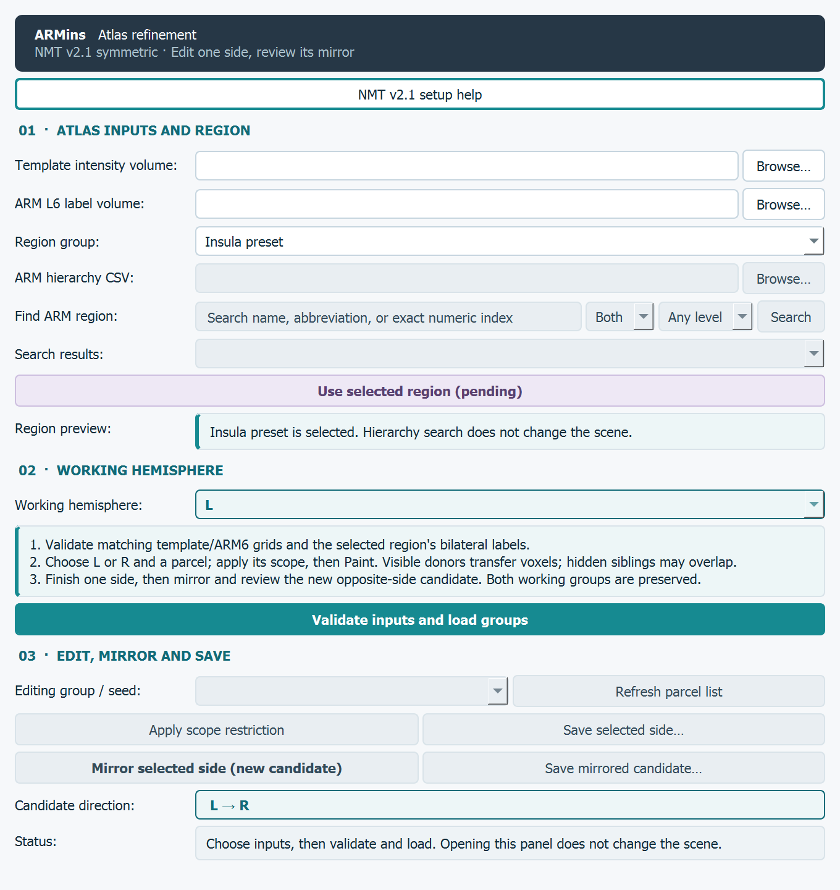

# ARMins

ARMins is a manually curated ARM atlas (use in combination with NMT v2.1 atlas) which have improved neuroanatomical parcellations for the insular cortices.
This re-parcellation is performed by Henry Evrard.
In this repo, we also provided a GUI that we built to allow similar processes to be applied to other cortices, for research groups specialised in particular cortices and looking for a finer regional annotation.

This source checkout provides the **3D Slicer editing GUI** for that work.
Curated atlas files and their anatomical review are separate deliverables;
the source-code tests do not establish a finished anatomical atlas release.
The insula preset is the starting workflow. Other ARM regions can be selected
through their explicit atlas hierarchy and edited with the same controls.

**Choose one working hemisphere, L or R; refine its parcels; validate; then
mirror the reviewed result into a separate opposite-side candidate.** This uses
the symmetry of the selected NMT v2.1 reference and avoids drawing the same
boundaries twice. Both original working groups remain available.

The complete guide below covers download, region selection, drawing, mirroring,
review and saving. Optional command-line operations follow the GUI workflow.

[Atlas setup](#atlas-setup) · [Symmetry](#why-work-on-one-hemisphere) ·
[Full GUI guide](#complete-editing-guide) · [Settings](#settings-and-saved-outputs) ·
[Command line](#optional-command-line-tools)

## Quick start

1. Download or clone this repository, then obtain the two atlas inputs below.
2. Open **View > Python Console** in 3D Slicer and run, replacing the example
   repository location with your checkout. Keep the checkout files together:

   ```python
   import sys
   sys.path.insert(0, "/path/to/ARMins")
   import armins
   armins.show_gui()
   ```

   On Windows, use a folder such as `r"C:\tools\ARMins"` in the second line.
3. Choose the template and ready-made ARM level-6 file with **Browse...**.
   The setup-help button opens the official AFNI links without changing the scene.
4. Choose **L** or **R**, select a region group, and follow the editing guide.
   Validate/load, edit and save that side, then use
   **Mirror selected side (new candidate)**.
   Inspect the separate opposite-side candidate before **Save mirrored
   candidate...**. Both original working nodes remain available.

The standard GUI workflow uses Slicer's bundled Python and NumPy. AFNI and an
external Python installation are optional; neither is required to select the
ready-made atlas files in Slicer.

## Atlas setup

Choose **NMT v2.1 symmetric**, using the standard 0.25 mm brain-focused files
from the same archive. The provider's general NMT overview still includes v2.0
examples, so select v2.1 explicitly rather than copying those examples unchanged.

- [Official symmetric NMT v2.1 archive](https://afni.nimh.nih.gov/pub/dist/atlases/macaque/nmt/NMT_v2.1_sym.tgz)
- [AFNI download directory](https://afni.nimh.nih.gov/pub/dist/atlases/macaque/nmt/)
- [AFNI @Install_NMT instructions](https://afni.nimh.nih.gov/pub/dist/doc/htmldoc/programs/alpha/%40Install_NMT_sphx.html)

**Without AFNI:** download the archive in a browser and extract it into a fresh
data folder outside this repository. A `.tgz` may require extracting the inner
`.tar` as well. Windows includes `tar`; 7-Zip is another extraction option.
An optional PowerShell example, run in that fresh data folder:

```powershell
curl.exe --fail --location --output NMT_v2.1_sym.tgz https://afni.nimh.nih.gov/pub/dist/atlases/macaque/nmt/NMT_v2.1_sym.tgz
tar -xzf NMT_v2.1_sym.tgz
```

**With AFNI installed** in a Linux, macOS or WSL terminal, use its installer
from a suitable data directory:

```sh
@Install_NMT -nmt_ver 2.1 -sym sym -install_dir ./atlas-data
```

After extraction, the relevant package layout is:

```text
NMT_v2.1_sym/                         outer archive folder
├── tables_ARM/
│   └── ARM_key_table.csv            choose for hierarchy search
└── NMT_v2.1_sym/                     standard brain-focused reference
    ├── NMT_v2.1_sym_SS.nii.gz        choose as Template intensity volume
    └── supplemental_ARM/
        └── ARM_6_in_NMT_v2.1_sym.nii.gz  choose as ARM L6 label volume
```

**Use the supplied `ARM_6` file directly. No conversion is needed for this
standard setup.** Its 3-D labels are equivalent to level 6 extracted from the
hierarchical ARM file. Keep the template and labels on their original matching
grid; do not substitute the low-resolution, full-head or asymmetric variant for
this workflow. ARMins validates the selected files and performs no registration
or resampling.


## Why work on one hemisphere?

The **symmetric NMT v2.1 template** supplies matching left/right voxel geometry.
For the tested standard 0.25 mm reference, reflection across physical **RAS
x = 0** maps voxel index `I` to `255 - I`; the corresponding NumPy axis in
Slicer is KJI axis 2. ARMins verifies the geometry instead of assuming this
formula for every image. The operation copies the edited masks onto the paired
voxel centres exactly, with **no interpolation, registration or smoothing**.

The workflow works in either direction:

| Working hemisphere | Finish here | Mirror result |
|---|---|---|
| L | Left working group | New right candidate, L → R |
| R | Right working group | New left candidate, R → L |

Before creating a candidate, ARMins checks the selected template's intensity
symmetry, the selected ARM label pairs, the source bindings, the native voxel
lattice and the edited partition. A symmetric-looking image or filename alone
is insufficient. The insula reference pair was measured to have zero reflected
intensity difference and zero paired-label mask mismatches; see provenance.json.

**Template symmetry is a construction choice.** It neither proves biological
symmetry nor identifies an anatomical boundary, and the symmetric intensity
image cannot independently establish physical laterality. Confirm the atlas
identities and coordinate geometry. Mirroring produces a candidate for review;
if the study needs hemisphere-specific boundaries, retain independent edits.

## Complete editing guide

### 1. Choose the inputs, region and working hemisphere

Open ARMins using Quick start and select the two files from Atlas setup.
Choose **L** or **R** as the working hemisphere.

For the original insula workflow, keep **Insula preset**. It uses eight ARM6
parcels per side: Iam/Iapm, Iai, Ial, Iapl, Pi, Ia/Id, Ig and Ri. Pi/Ri are
included in this operational editing scope; this does not declare that all
eight are core insular cortex.

For another region, choose **ARM hierarchy** and select
`tables_ARM/ARM_key_table.csv` from the same NMT archive. Search by abbreviation,
full name or numeric ID; optionally restrict the hierarchy level. Select one
specific parent result, inspect its level-6 descendants, then click
**Use selected region (pending)**. Searching and previewing do not change the Slicer scene.

For example, **CL_ACC, level 3, ID 3** groups the left level-6 IDs
**4, 5, 8, 9 and 10**; its paired right IDs are **504, 505, 508, 509 and 510**.
This example demonstrates table-based grouping, not a new anatomical definition.
The preview retains hemisphere and cortical/subcortical identity, so identical
short names in different namespaces are not conflated.

A search such as “insula” can find several distinct hierarchy nodes. Select
the intended result; ARMins does not merge all search hits. The original
eight-label insula preset spans multiple hierarchy branches and remains a
separate preset rather than being replaced by a broader parent. The flat
`ARM_key_all.txt` is not a substitute for the hierarchy CSV: First_Level and
Last_Level describe label availability, not parent-child paths.



The dialog uses dark text, teal section accents and a purple **Use selected region**
action. Its pale-purple state is disabled. Working-side cues use teal for L and
amber for R, alongside explicit hemisphere and mirror-direction text.


The actual editor before loading: hierarchy controls become available when
**ARM hierarchy** is selected; **Candidate direction** follows the working side.

### 2. Load and check the starting groups

Click **Validate inputs and load groups**. In **Segment Editor**, confirm:

- **Segmentation:** the selected region's working group for your chosen side.
- **Source volume:** the selected NMT intensity template.
- **Segments:** one editable scope plus the expected ARM6 parcels shown in
  the preview. The insula preset starts with nine segments per side.

The scope is the union of the selected level-6 labels. Original atlas files
are preserved. Changing the region creates a distinct group; it does not
replace edits in another group's nodes. Loading/validating does not mirror
anything. Do not change the image geometry or add a parent transform.

### 3. Select a parcel and set the editing restriction

In ARMins choose the receiving parcel, then click **Apply scope restriction**.
Check Segment Editor's **Editable area**: it must be **Inside single segment**,
using the selected side's scope. The scope becomes hidden while drawing.

Under **Modify other segments**, use **Overwrite visible** (some Slicer builds
label it **Overwrite visible value**). Keep parcels that may donate voxels
visible. Painting adds to the selected parcel and removes the same voxels from
those visible donor parcels. A hidden parcel is protected from removal, but it
can still overlap newly painted voxels; visibility alone is not an editing mask.
See the [Slicer masking documentation](https://slicer.readthedocs.io/en/latest/user_guide/modules/segmenteditor.html#masking-options).

For a change confined to one original parcel or a pair of neighbours, preserve
that local parent before editing and select it as the Editable area. The short
optional recipe below creates that mask. Clicking **Apply scope restriction**
again selects the broader group scope, so reselect the local mask afterwards.

### 4. Refine a boundary or subdivide a parcel

**Boundary refinement:** select the receiving parcel, keep its intended donor
visible, choose **Paint**, and move their shared boundary. Inspect neighbouring
slices and all three anatomical planes. Transfer voxels between parcels;
erasing without assigning a receiving parcel can create a gap.

**Subdivision:** create a child from Slicer's Python Console, using the same
working side as the GUI, for example:

```python
child_id = armins.add_parcel("review-child", "L")  # use "R" for right
```

Click **Refresh parcel list**, select the child, and apply the scope restriction.
For a split of a single parent, select its preserved local mask as Editable area,
keep the original parent visible and paint the child. The original parcel now
contains the remainder. Keep original ARM names/IDs intact and keep the
`L-`/`R-` ID/name created for the custom child. A scientific name and its new
output integer ID belong in the eventual curated label table.

The child plus remainder must reconstruct the saved parent without gaps,
overlaps or growth outside it. Keep helper masks hidden and unchanged. Record
the anatomical rationale and review status separately from software validation.

### 5. Validate and mirror the finished side

Save the edited working side with **Save selected side…**. Then optionally run
a read-only preflight in the Python Console:

```python
print(armins.mirror_side("L", dry_run=True))  # use "R" for right
```

The report includes the input hashes, reflection direction, paired identities
and partition checks. A valid partition has **zero gaps, zero overlaps and
zero voxels outside the selected scope**. Helper masks are excluded. Resolve
any refusal in the source edit before proceeding; do not bypass the checks.

Confirm the working side and click **Mirror selected side (new candidate)**.
The new candidate is on the opposite side. Both existing working groups remain
unchanged. The official labels use the table's paired identities; custom
children change `L-` ↔ `R-`. An ID offset is not assumed for arbitrary pairs.

A mirror is a snapshot, not a live link. If you revise the source again, create
and review another candidate. There is no need to redraw the same boundaries
on the other side when a symmetric atlas product is intended.

### 6. Inspect, save and reopen

In **Data**, hide the untouched opposite-side working group when viewing the
new candidate. Also hide the original ARM label overlay if it obscures the
result. Keep the NMT intensity background visible. Inspect the candidate's
parcel names, extent and paired boundaries in all three slice planes; toggle
source/candidate visibility so the intended group is clear.

Click **Save mirrored candidate…** and choose a new `.seg.nrrd` path. Existing
paths are refused. A typical L → R result consists of the edited left working
segmentation and the separately saved right candidate; the original right
working group is still an unedited baseline. Reverse these roles for R → L.

Reload the saved `.seg.nrrd` through **File > Add Data** and inspect names,
extent and voxel masks. Save the Slicer scene too when you want to resume the
full editing context, keeping its referenced files available. The candidate's
scope segment retains the mirror receipt; general node attributes need a scene
save. A segmentation-only reload is useful for inspection and does not by
itself restore every editor/source binding needed for further mirroring.

**The current final output of this workflow is a reviewed Slicer segmentation.**
Full bilateral integer-label NIfTI export/merge is not implemented. Do not
export scope/helper masks with the parcels or assume segment order/tags assign
correct atlas integers. A future atlas export needs an explicit label table and
verification that the original grid and all unedited regions are preserved.

### Optional: preserve a local parent before drawing

For the default left insula boundary example, capture Ial + Ia/Id before the
edit. For another region, use the preview's selected ARM6 IDs instead. For a
subdivision, list only the single original parent. This creates a helper in
the current working group; it does not copy or modify the source atlas file.

```python
import numpy as np
import slicer
side = "L"  # must match the GUI; right example uses IDs 542 and 728
parent_ids = ["ARM_L6_42", "ARM_L6_228"]
group = slicer.mrmlScene.GetFirstNodeByName(armins.ACTIVE_SEG_NAMES[side])
ref = slicer.mrmlScene.GetFirstNodeByName(armins.ACTIVE_T1_NAME)
parent_mask = np.logical_or.reduce([
    slicer.util.arrayFromSegmentBinaryLabelmap(group, sid, ref).astype(bool)
    for sid in parent_ids
])
parent_id = armins.add_parcel("local-parent", side)
slicer.util.updateSegmentBinaryLabelmapFromArray(
    parent_mask.astype(np.uint8), group, parent_id, ref)
group.GetSegmentation().GetSegment(parent_id).SetTag(
    "Insula.MirrorRole", "helper_mask")
group.GetDisplayNode().SetSegmentVisibility(parent_id, False)
```

In Segment Editor choose **Editable area > Inside single segment > L-local-parent**
(or the corresponding right helper). Keep it hidden. Capture it once before
editing; rerunning with the same name is refused. Tagged helpers are omitted
from parcel partition checks and remain hidden in mirror candidates.

### Troubleshooting

| Symptom | Check or action |
|---|---|
| No hierarchy results | Use `ARM_key_table.csv`, check side/level and try the official abbreviation or numeric ID. |
| Painting does nothing | Confirm the selected parcel, Paint effect and Editable area; inspect the mask and any intensity restriction. |
| A hidden parcel overlaps the edit | Restore the intended local parent mask and transfer the disputed voxels to only one parcel; hiding it does not constrain painting. |
| Mirror reports a gap, overlap or leak | Correct the working partition; helper masks must have the explicit helper tag. |
| Mirror rejects geometry or symmetry | Check the matching symmetric inputs and parent transforms. Do not flip array indices or resample labels to bypass the check. |
| Candidate seems doubled or unchanged | Hide the opposite-side baseline and original ARM overlay; select the new candidate explicitly. |
| Source changed after mirroring | Create a new candidate and review it; saved candidates do not update automatically. |

## Settings and saved outputs

| Setting | Default | Effect |
|---|---|---|
| Template and ARM6 inputs | Blank GUI selectors | Choose matching 3-D volumes explicitly. |
| `ARMINS_TEMPLATE` | Unset | Optional template path before opening ARMins. |
| `ARMINS_ATLAS` | Unset | Optional 3-D ARM level-6 path. |
| `ARMINS_OUTPUT_DIR` | `./outputs` | Initial folder for save dialogs. |
| Region group | Insula preset | Keep the original eight labels/side or select one explicit ARM hierarchy parent. |
| Hierarchy table | Optional auto-discovery near the selected atlas | Select the matching external `tables_ARM/ARM_key_table.csv` for search. |
| `ARMINS_HIERARCHY` | Unset | Optional path to the explicit ARM hierarchy CSV. |
| Working hemisphere | L | Choose L or R; the initial editor focus and mirror direction follow this selection. |
| `refresh_scopes` | `False` | Preserve a changed scope and refuse reuse; explicit `run(refresh_scopes=True)` replaces it from the source atlas. Save edits first. |

Equivalent programmatic configuration inside Slicer:

```python
armins.configure(template_path="/path/to/template.nii.gz",
          atlas_path="/path/to/ARM_6.nii.gz",
          output_dir="/path/to/edits")
armins.show_gui()
```

For explicit console selection of a hierarchy parent, after configuring the
matching template and ARM6 inputs:

```python
from arm_hierarchy import ArmHierarchy
resolver = ArmHierarchy.from_file("/path/to/tables_ARM/ARM_key_table.csv")
print(resolver.search("ACC", side="R", level=3))
profile = resolver.profile_for(503, 3, "R")
armins.run(region_profile=profile, working_side="R")
```

The paired region profile identifies the same group whether selected from L or
R; the working hemisphere is a separate choice. Its source table/hash, selected
parent, leaf identities and bilateral correspondence are retained with the
group and mirror receipt. Switching groups preserves earlier nodes.

Save each working side separately as `.seg.nrrd`; save the Slicer scene when
you need the full editing context. Mirrored candidates have a separate save
action that refuses an existing file. The saved candidate's scope carries the
JSON mirror receipt, and parcel tags retain direction, source hashes and
annotation metadata. General MRML node attributes require a scene save.
Paired parcels share display colours; the palette can repeat for large groups
and does not itself encode anatomical relationships.

Scope/helper masks overlap parcels by design. Exclude them from any later
label-map export. Segment IDs and metadata tags do not guarantee exported NIfTI
integers. Full bilateral integer-label NIfTI export/merge is not implemented.

## Optional command-line tools

These terminal commands require ordinary Python with the optional CLI/test
dependencies:

```sh
python -m pip install -r requirements.txt
python armins.py --help
python armins.py check --template /path/to/NMT_v2.1_sym_SS.nii.gz --atlas /path/to/ARM_6_in_NMT_v2.1_sym.nii.gz --dry-run
```

Search the external hierarchy without loading Slicer or changing any data:

```sh
python armins.py search --hierarchy /path/to/tables_ARM/ARM_key_table.csv --query ACC --side R --level 3 --dry-run
```

The results report the specific parent identities, source-table hash and
descendant level-6 IDs. Select a result explicitly in the GUI; a search does
not create an editing group by itself.

`check` is read-only and reports resolved paths, hashes, geometry and label
counts. If you only have the hierarchical `ARM_in_NMT_v2.1_sym.nii.gz`, use:

```sh
python armins.py prepare --template /path/to/NMT_v2.1_sym_SS.nii.gz --atlas /path/to/ARM_in_NMT_v2.1_sym.nii.gz --level 6 --output-dir /path/to/prepared-arm --dry-run
```

After reviewing the resolved inputs and destinations, repeat without
`--dry-run`. Preparation supports the explicit six-level 4-D layout and the
original 5-D layout with a singleton axis. It writes only `ARM_L6.nii.gz` and
`armins_prepare_receipt.json`, preserves the template by reference, and refuses
existing destinations. A supplied 3-D ARM6 file is returned without duplication.


## Validation and review

```sh
python -m unittest discover -s tests -p "test_*.py" -v
```

The 0.7.0 hierarchy snapshot passed **49 distinct synthetic tests**, a read-only pairing
audit of all **837 left-side hierarchy nodes** and their right counterparts,
and separate native **Slicer 5.12.0** checks for both the insula and ACC groups.
The native tests exercise search/pending-selection non-mutation, L/R focus,
paired group reuse, exact mirroring, preserved earlier groups/editor state,
hidden helpers, and save/reload. These are technical checks, not anatomical
validation.

The 0.7.1 GUI update passed the same 49 synthetic tests, five native design/help
checks and 11 native hierarchy checks after visual review. Its stylesheet is
local to the ARMins dialogs; atlas and mirror algorithms are unchanged.

The array, editor, NIfTI and CLI tests use synthetic fixtures. Native Slicer
testing uses explicitly supplied external inputs and a separate testing scene;
see `tests/slicer_smoke.py` for its required environment variables. The behavior
phase needs Slicer's main-window layout manager. Use `--testing --no-splash
--python-script tests/slicer_smoke.py`, with an absolute script path when needed.
The setup-help/design phase may also use `--no-main-window`.

The exact tested code hashes and validation scope are recorded in
[provenance.json](provenance.json). Technical validation does not establish
anatomical boundary accuracy, physical laterality or biological symmetry.

Review in order: verify the two selected input files; inspect one edited side
and its separate mirror candidate; then save/reload and review parcel identity
and extent. Scientific acceptance remains a human judgment.

## Repository and attribution

`armins.py` is the standalone operator entry point. [CHANGELOG.md](CHANGELOG.md)
tracks behavior/version changes; [the project note](docs/project_note.md)
records decisions, validation and pending work. Inputs, edits and generated
receipts are external to the public source tree and excluded from Git.

Obtain NMT/ARM data separately and follow the provider's terms and citation
instructions. Relevant atlas references include
[Jung et al. (2021)](https://doi.org/10.1016/j.neuroimage.2021.117997) and
[Hartig et al. (2021)](https://doi.org/10.1016/j.neuroimage.2021.117996).
The hierarchy lookup follows the existing region-analysis and initial region-
parser pattern: find one exact node, collect its descendants, then retain its
level-6 labels. ARM identities come from the selected provider CSV; another
ontology's identifiers, coordinates and network services are not imported.

The GUI supports expert-led curation; its test candidates are not an official
new atlas release. Curated atlas revisions need their own label table, anatomical
review and release record. A project code license has not been selected.
