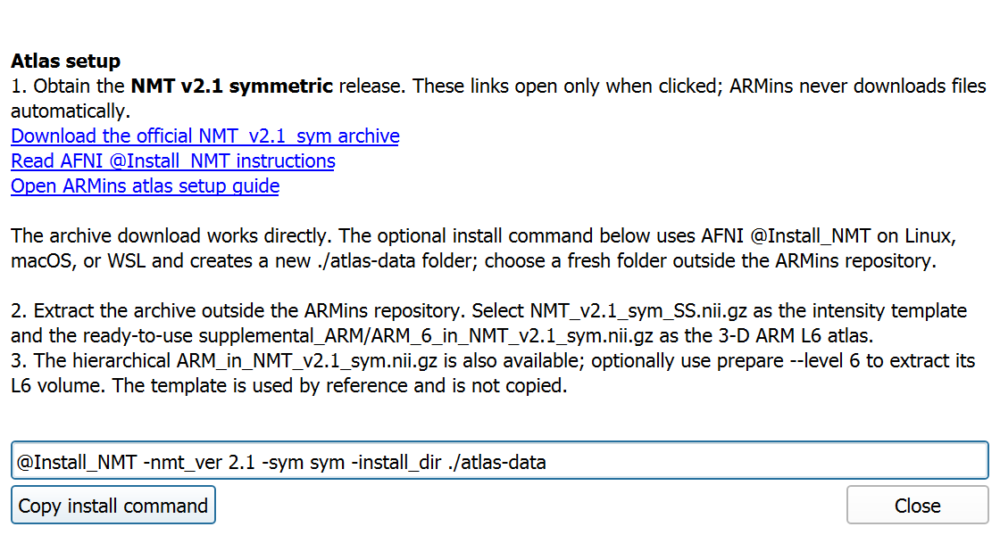

# ARMins

Manual insula reparcellation and symmetric mirror candidates in **3D Slicer**,
starting from ARM level 6 in the symmetric NMT v2.1 template.

ARMins creates independent left/right working segmentations, preserves the
original ARM seeds, and mirrors one edited side across the physical RAS midline
into a separate candidate. It checks source bindings, voxel geometry, atlas
symmetry, parcel identity, gaps, overlaps and leaks before creating a mirror.
It does not choose anatomical boundaries or establish biological symmetry.

## Quick start

1. Download or clone this repository, then obtain the two atlas inputs below.
2. Open **View > Python Console** in 3D Slicer and run, replacing the example
   repository location with your checkout:

   ```python
   exec(open("/path/to/ARMins/armins.py", encoding="utf-8").read())
   ```

   On Windows, a raw string such as `r"C:\tools\ARMins\armins.py"` also works.
3. Choose the template and ready-made ARM level-6 file with **Browse...**, then
   click **Validate inputs and load groups**. The setup-help button opens the
   official AFNI links without changing the scene.
4. Edit and save one side, then use **Mirror selected side (new candidate)**.
   Inspect the separate opposite-side candidate before **Save mirrored
   candidate...**. Both original working nodes remain available.

The standard GUI workflow uses Slicer's bundled Python and NumPy. AFNI and an
external Python installation are optional; neither is required to select the
ready-made atlas files in Slicer.

## Atlas setup

Choose **NMT v2.1 symmetric**, using the standard 0.25 mm brain-focused files
from the same archive. The provider's general NMT overview still includes v2.0
examples, so select v2.1 explicitly rather than copying those examples unchanged.

- [Official symmetric NMT v2.1 archive](https://afni.nimh.nih.gov/pub/dist/atlases/macaque/nmt/NMT_v2.1_sym.tgz)
- [AFNI download directory](https://afni.nimh.nih.gov/pub/dist/atlases/macaque/nmt/)
- [AFNI @Install_NMT instructions](https://afni.nimh.nih.gov/pub/dist/doc/htmldoc/programs/alpha/%40Install_NMT_sphx.html)

**Without AFNI:** download the archive in a browser and extract it into a fresh
data folder outside this repository. A `.tgz` may require extracting the inner
`.tar` as well. Windows includes `tar`; 7-Zip is another extraction option.
An optional PowerShell example, run in that fresh data folder:

```powershell
curl.exe --fail --location --output NMT_v2.1_sym.tgz https://afni.nimh.nih.gov/pub/dist/atlases/macaque/nmt/NMT_v2.1_sym.tgz
tar -xzf NMT_v2.1_sym.tgz
```

**With AFNI installed** in a Linux, macOS or WSL terminal, use its installer
from a suitable data directory:

```sh
@Install_NMT -nmt_ver 2.1 -sym sym -install_dir ./atlas-data
```

After extraction, the relevant package layout is:

```text
NMT_v2.1_sym/                         outer archive folder
└── NMT_v2.1_sym/                     standard brain-focused reference
    ├── NMT_v2.1_sym_SS.nii.gz        choose as Template intensity volume
    └── supplemental_ARM/
        └── ARM_6_in_NMT_v2.1_sym.nii.gz  choose as ARM L6 label volume
```

**Use the supplied `ARM_6` file directly. No conversion is needed for this
standard setup.** Its 3-D labels are equivalent to level 6 extracted from the
hierarchical ARM file. Keep the template and labels on their original matching
grid; do not substitute the low-resolution, full-head or asymmetric variant for
this workflow. ARMins validates the selected files and performs no registration
or resampling.



### Optional input validation or hierarchy extraction

These terminal commands require ordinary Python with the optional CLI/test
dependencies:

```sh
python -m pip install -r requirements.txt
python armins.py --help
python armins.py check --template /path/to/NMT_v2.1_sym_SS.nii.gz --atlas /path/to/ARM_6_in_NMT_v2.1_sym.nii.gz --dry-run
```

`check` is read-only and reports resolved paths, hashes, geometry and label
counts. If you only have the hierarchical `ARM_in_NMT_v2.1_sym.nii.gz`, use:

```sh
python armins.py prepare --template /path/to/NMT_v2.1_sym_SS.nii.gz --atlas /path/to/ARM_in_NMT_v2.1_sym.nii.gz --level 6 --output-dir /path/to/prepared-arm --dry-run
```

After reviewing the resolved inputs and destinations, repeat without
`--dry-run`. Preparation supports the explicit six-level 4-D layout and the
original 5-D layout with a singleton axis. It writes only `ARM_L6.nii.gz` and
`armins_prepare_receipt.json`, preserves the template by reference, and refuses
existing destinations. A supplied 3-D ARM6 file is returned without duplication.

## Editing and mirroring

Work on one side at a time. Select the receiving parcel and keep only the
intended donor parcels visible for **Overwrite visible**. Hidden parcels can
overlap an edit; hiding a parcel does not constrain the receiving parcel.

For a local boundary refinement, preserve the union of the involved original
regions as a local parent mask. Select that mask under Segment Editor's
**Editable area > Inside single segment**. The loader's **Apply scope
restriction** button uses the broader full-insula scope; applying it again
replaces the local-mask selection.

For a subdivision, create a child with `add_parcel("child", "L")` or `"R"`,
transfer voxels from the remaining parent, and check that child plus remainder
reconstructs the original parent without gaps, overlap or growth outside it.
Do not use erase-only drawing to define an unlabeled gap.

Preserved helper masks also need explicit side IDs. For example:

```python
parent_id = add_parcel("parent-mask", "L")
# Fill the helper from the original parent using Logical operators, then:
group = slicer.mrmlScene.GetFirstNodeByName(ACTIVE_SEG_NAMES["L"])
group.GetSegmentation().GetSegment(parent_id).SetTag(
    "Insula.MirrorRole", "helper_mask")
```

Keep helpers hidden. Explicitly tagged helpers are excluded from parcel
partition checks and remain hidden in the candidate. Unknown or ambiguous
segments are refused rather than silently dropped.

Before mirroring, a console dry run reports the complete resolved preflight:

```python
print(mirror_side("L", dry_run=True))  # or "R"
candidate = mirror_side("L")
```

The eight starting parcels include Pi and Ri in the editing scope. This is an
explicit operational union, not a claim that all eight are core insular cortex.
Official ARM IDs/names are retained; their paired hemispheric IDs differ by
500. Custom children use explicit `L-` / `R-` IDs and names. The candidate uses
exact integer-grid reflection across **RAS x = 0**, without interpolation.

## Settings and saved outputs

| Setting | Default | Effect |
|---|---|---|
| Template and ARM6 inputs | Blank GUI selectors | Choose matching 3-D volumes explicitly. |
| `ARMINS_TEMPLATE` | Unset | Optional template path before opening ARMins. |
| `ARMINS_ATLAS` | Unset | Optional 3-D ARM level-6 path. |
| `ARMINS_OUTPUT_DIR` | `./outputs` | Initial folder for save dialogs. |
| Editing side | L | GUI selector; mirroring also supports R to L. |
| `refresh_scopes` | `False` | Preserve a changed scope and refuse reuse; explicit `run(refresh_scopes=True)` replaces it from the source atlas. Save edits first. |

Equivalent programmatic configuration inside Slicer:

```python
configure(template_path="/path/to/template.nii.gz",
          atlas_path="/path/to/ARM_6.nii.gz",
          output_dir="/path/to/edits")
show_gui()
```

Save each working side separately as `.seg.nrrd`; save the Slicer scene when
you need the full editing context. Mirrored candidates have a separate save
action that refuses an existing file. The saved candidate's scope carries the
JSON mirror receipt, and parcel tags retain direction, source hashes and
annotation metadata. General MRML node attributes require a scene save.

Scope/helper masks overlap parcels by design. Exclude them from any later
label-map export. Segment IDs and metadata tags do not guarantee exported NIfTI
integers. Full bilateral integer-label NIfTI export/merge is not implemented.

## Validation and review

```sh
python -m unittest discover -s tests -p "test_*.py" -v
```

The array, editor, NIfTI and CLI tests use synthetic fixtures. Native Slicer
testing uses explicitly supplied external inputs and a separate testing scene;
see `tests/slicer_smoke.py` for its required environment variables. The behavior
phase needs Slicer's main-window layout manager. Use `--testing --no-splash
--python-script tests/slicer_smoke.py`, with an absolute script path when needed.
The setup-help/design phase may also use `--no-main-window`.

The exact tested code hashes and validation scope are recorded in
[provenance.json](provenance.json). Technical validation does not establish
anatomical boundary accuracy, physical laterality or biological symmetry.

Review in order: verify the two selected input files; inspect one edited side
and its separate mirror candidate; then save/reload and review parcel identity
and extent. Scientific acceptance remains a human judgment.

## Repository and attribution

`armins.py` is the standalone operator entry point. [CHANGELOG.md](CHANGELOG.md)
tracks behavior/version changes; [the project note](docs/project_note.md)
records decisions, validation and pending work. Inputs, edits and generated
receipts are external to the public source tree and excluded from Git.

Obtain NMT/ARM data separately and follow the provider's terms and citation
instructions. Relevant atlas references include
[Jung et al. (2021)](https://doi.org/10.1016/j.neuroimage.2021.117997) and
[Hartig et al. (2021)](https://doi.org/10.1016/j.neuroimage.2021.117996).
ARMins is an independent editing tool; its candidate outputs are not an
official new atlas release. A project code license has not been selected.
